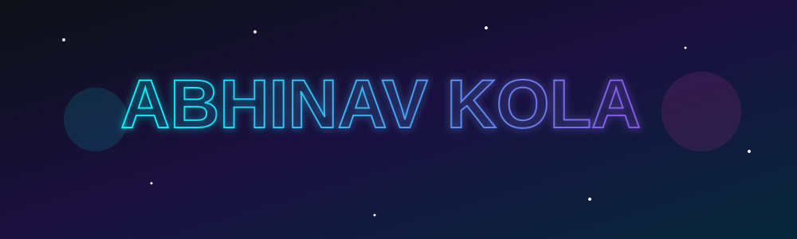
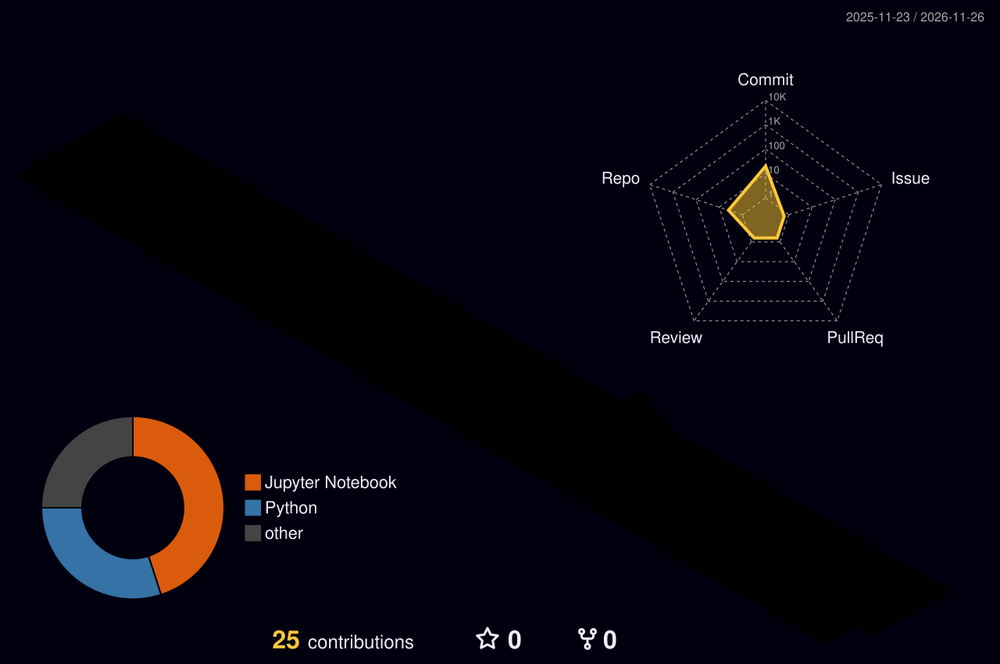

  

📍 Hyderabad, India

---

## 👨‍💻 About Me

<table>
<tr>
<td width="56%" valign="top">

- 🎓 Postgraduate in **AI/ML** (MCA, KL University)
- 🤖 Into **Generative AI, LLM applications, NLP and applied ML**
- 🧠 Building with Python, data tools, retrieval workflows and modern web tech
- 🚀 Learning by shipping projects and solving real-world problems
- 🏀 Off the keyboard: basketball and netball

</td>
<td width="44%" align="center">

</td>
</tr>
</table>

## 🧰 Tech Stack

**Languages**  

**AI / Machine Learning**  

**Web / Data / Tools**  

## 🚀 Featured Projects

<table>
<tr>
<td width="50%" valign="top">

### 🔎 [Context-Aware Research Brief Generator](https://github.com/ABHI6969-AK/context-aware-research-brief-generator)
Structured, evidence-linked research briefs with follow-up queries and multiple interfaces.

`Python` `LangGraph` `LangChain` `FastAPI`

</td>
<td width="50%" valign="top">

### 🏆 [Sports Quiz Agent](https://github.com/ABHI6969-AK/sports-quiz-agent)
Retrieval-augmented sports quiz generation over a searchable knowledge base. [Live demo ↗](https://sports-quiz-agent.streamlit.app)

`Python` `ChromaDB` `RAG` `Streamlit`

</td>
</tr>
<tr>
<td width="50%" valign="top">

### 👥 [Customer Segmentation](https://github.com/ABHI6969-AK/Customer__Segmentation)
Segments customers to support targeted marketing and data-driven decisions.

`Python` `Pandas` `Scikit-learn`

</td>
<td width="50%" valign="top">

### 📈 [Sales Analysis Project](https://github.com/ABHI6969-AK/Sales-Analysis-Project)
Explores sales drivers and trains a Random Forest model for sales prediction.

`Python` `Pandas` `Scikit-learn`

</td>
</tr>
<tr>
<td colspan="2" valign="top">

### 🔥 [Expert Thermal Heat Sink Surrogate](https://github.com/ABHI6969-AK/expert-thermal-heat-sink-surrogate)
Heat-sink parameter sweep and surrogate modelling project.

`Jupyter Notebook`

</td>
</tr>
</table>

## 📊 GitHub Statistics

<!-- If the stats cards show "rate limit" errors, deploy your own github-readme-stats on Vercel and swap the host below. -->

  
  

  

  

## 🏙️ Contributions in 3D

<!-- Shows after the workflow has run once. -->

  

## 🐍 Contribution Snake

<!-- Shows after the workflow has run once. -->
<picture>
  <source media="(prefers-color-scheme: dark)" srcset="https://raw.githubusercontent.com/ABHI6969-AK/ABHI6969-AK/output/github-contribution-grid-snake-dark.svg">
  <source media="(prefers-color-scheme: light)" srcset="https://raw.githubusercontent.com/ABHI6969-AK/ABHI6969-AK/output/github-contribution-grid-snake.svg">
  
</picture>

---

**Build · Learn · Ship · Repeat**

